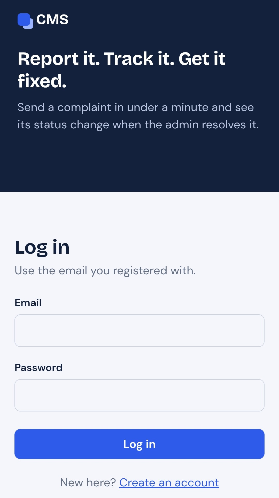
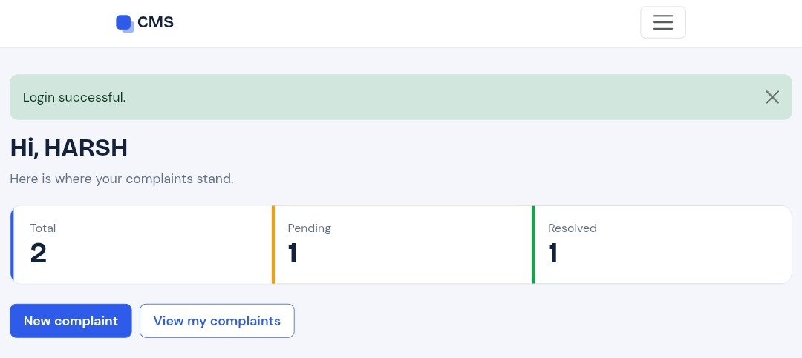
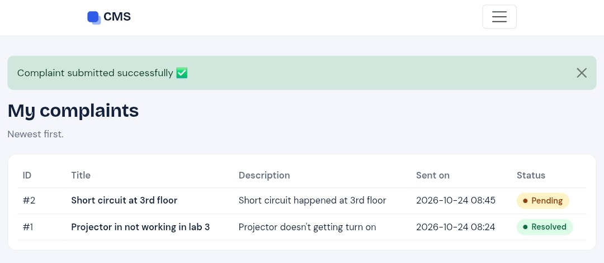
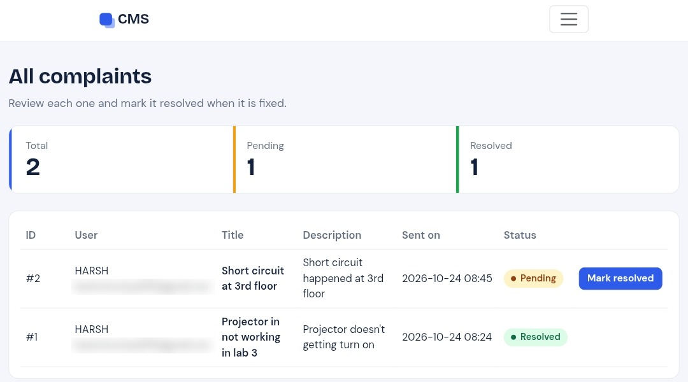

# Complaint Management System (CMS)

A Flask + SQLite web app where users register, log in and submit complaints, and an admin reviews and resolves them.

**Live app:** https://priyanshu8810.pythonanywhere.com

## Screenshots

**Login**



**User dashboard**



**My complaints**



**Admin panel**



## Features
- Registration and login with hashed passwords (Werkzeug)
- Role-based access for user and admin, using `login_required` and `admin_required` decorators
- Users submit complaints and track status and date
- Admin panel with summary counts, full complaint details and a "Mark resolved" action
- CSRF protection on every POST form, parameterized SQL queries, session reset on login and logout
- Responsive Bootstrap 5 UI with custom CSS

## Tech stack
Python, Flask, SQLite, Jinja2, HTML, CSS, Bootstrap 5

## Run locally
```bash
pip install -r requirements.txt
python app.py
```
Open http://127.0.0.1:5000

The database is created automatically on first run.
Set the `SECRET_KEY` and `ADMIN_PASSWORD` environment variables for any real deployment. For local testing, the default admin is `admin@gmail.com` / `admin123`.

## Project structure
```
app.py            # routes, database helpers, auth and CSRF logic
templates/        # Jinja2 templates (base.html + pages)
static/style.css  # custom styles
requirements.txt
```

## Possible improvements
- Complaint categories and priority
- Email notification when a complaint is resolved
- Search and filters in the admin panel
